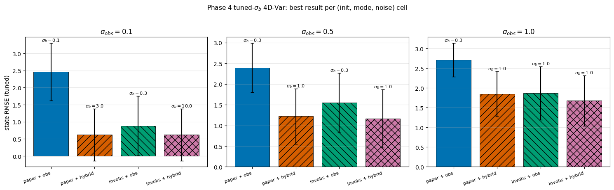
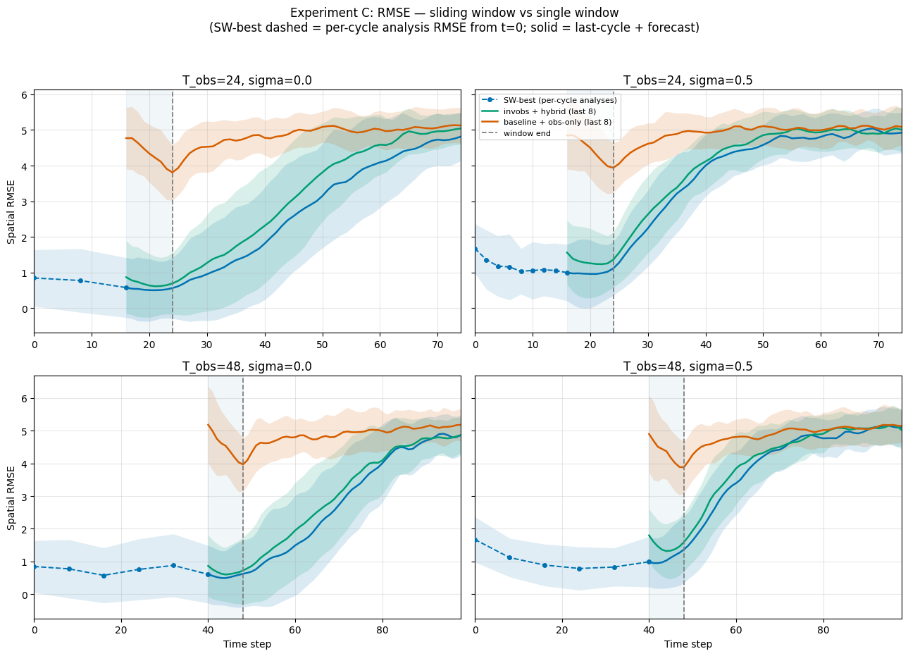
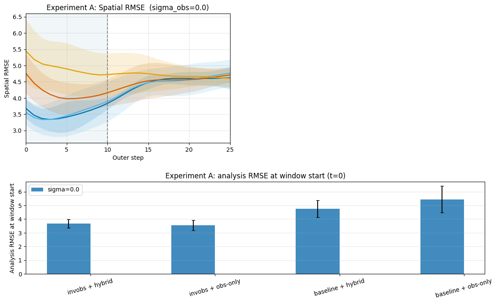

# Variational data assimilation with a learned inverse observation operator (PyTorch port)

This repository is a fork of [googleinterns/invobs-data-assimilation](https://github.com/googleinterns/invobs-data-assimilation), the code for Frerix et al., [*Variational Data Assimilation with a Learned Inverse Observation Operator*](https://arxiv.org/abs/2102.11192) (ICML 2021). The original code is JAX and Flax. This fork reimplements the method in PyTorch and tests it in settings the paper did not cover. It is the AM 170B capstone project of a five-person team. It is a research project, not an official Google product.

The method trains a convolutional network that maps sparse observations back to the full physical state. 4D-Var data assimilation uses that network to initialize the solve and to reshape the objective, which avoids the poor local minima that sparse observations create. The test systems are the 1D Lorenz-96 model and 2D Kolmogorov flow.

## What this fork adds

The report in [`paper/main.pdf`](paper/main.pdf) describes three extensions of the original paper:

- **Full 4D-Var cost.** The cost is `J = J_b + J_o`, with a background term and an explicit observation-error covariance. The paper uses a simplified observation-misfit objective.
- **Observation noise.** Every experiment adds Gaussian noise to the observations. The Lorenz-96 experiments use noise standard deviations of 0.1, 0.5, and 1.0 in the single-window sweep and 0.0 and 0.5 in the cycling experiments.
- **Sliding-window (cycling) 4D-Var.** The solver runs over successive windows, and the propagated previous analysis serves as the background for the next window.

The repository also contains an assimilation-window sweep with gradient diagnostics (`PyTorch_InvObs_DA_WindowSweep_Corrected.ipynb`) and a comparison of a fixed-step RK4 integrator with an adaptive one.

## Repository layout

| Path | Contents |
|---|---|
| `PyTorch_InvObs_DA.ipynb` | The first PyTorch port: Lorenz-96, the inverse-observation CNN, 4D-Var with a noise sweep, and Kolmogorov flow. |
| `PyTorch_InvObs_DA_WindowSweep_Corrected.ipynb` | Assimilation-window sweep on Lorenz-96 with gradient diagnostics. It loads a cached CNN checkpoint. |
| `PyTorch_InvObs_DA_v2_PaperFaithful.ipynb` | Trains a CNN that follows the paper's architecture, compares baseline initializations, and sweeps the background error `sigma_b`. |
| `PyTorch_InvObs_DA_v2_Integrator.ipynb` | Fixed-step RK4 versus adaptive dopri5, and a Lyapunov-time estimate. |
| `PyTorch_InvObs_DA_v2_Kolmogorov.ipynb` | Kolmogorov flow: data, inverse-observation CNN training, and evaluation. |
| `SlidingWindow_PyTorch_final.ipynb` | Sliding-window 4D-Var on Lorenz-96. |
| `SlidingWindow_Kolmogorov_PyTorch.ipynb` | Sliding-window 4D-Var on Kolmogorov flow. |
| `pytorch_invobs_lib.py`, `pytorch_paper_inverter.py`, `pytorch_kolmogorov.py` | Shared PyTorch code imported by the `v2` and Kolmogorov notebooks. |
| `notebook_setup.py` | Environment detection, package installation, cache directory, and device selection for the `v2` notebooks. |
| `plot_noise_distributions.py` | Draws the noise-distribution figure used in the report. |
| `tests/` | `pytest` tests for `pytorch_paper_inverter.py`. |
| `paper/` | LaTeX source of the report, its figures, and the compiled `main.pdf`. See [`paper/README.md`](paper/README.md). |
| `paper_scripts/`, `config_files/` | The original JAX pipeline from the upstream repository. See [`docs/jax-pipeline.md`](docs/jax-pipeline.md). |
| `figures/` | Figures that the notebooks and the original analysis save. |

## Set up and run

The notebooks hold their executed outputs, so you can read the results without running anything.

To run them, install PyTorch and the packages that the notebooks import: `numpy`, `matplotlib`, `pandas`, and `torchdiffeq`. `plot_noise_distributions.py` also needs `scipy`, and the tests need `pytest`. The `v2` notebooks install any missing package themselves through `notebook_setup.py`. Do not install `requirements.txt` for the PyTorch code. It pins the legacy JAX stack of `paper_scripts/` and adds `torchdiffeq`.

1. Clone the repository and start Jupyter from its root. The notebooks import modules from the repository root.
2. Open `PyTorch_InvObs_DA.ipynb` first. Its header says that the defaults run in a few minutes on a Colab GPU. Other notebooks use longer training, for example 500 epochs in `PyTorch_InvObs_DA_v2_PaperFaithful.ipynb`.
3. Set the cache directory. The `v2` notebooks read the environment variable `INVOBS_CACHE_DIR` and fall back to `~/invobs_cache`. `PyTorch_InvObs_DA.ipynb` and `SlidingWindow_PyTorch_final.ipynb` hard-code `CACHE_DIR = '/content/drive/MyDrive/invobs_cache'`, a Google Drive path, so edit that line to run them locally. The repository stores no trained weights, so the first run trains the networks.
4. `PyTorch_InvObs_DA_WindowSweep_Corrected.ipynb` raises an error unless the cache directory already holds `l96_inverter_sigma0.0_n32000_ep500.pt`. The repository does not say which run produces that file, so train it first or use a cache that has it.

To run the tests from the repository root:

```
pytest tests/test_paper_inverter.py -v
```

To rebuild the report:

```
cd paper
latexmk -pdf main.tex
```

The Kolmogorov solver uses `torch.fft.rfft2`, and the report states that the 2D experiments ran on the CPU only.

## Main results

All numbers below come from the report in `paper/`. The ensembles are small, so read the differences as tendencies.

### Lorenz-96, tuned full 4D-Var

The experiment sweeps `sigma_b` over {0.1, 0.3, 1.0, 3.0, 10.0}, with 10 of 40 grid points observed, N = 16 trajectories, and a window of T = 10 steps. The table lists the best analysis RMSE on the initial state, with the chosen `sigma_b` in parentheses. "paper" is the climatological-mean baseline initialization, and "invobs" is the learned-inverse initialization. "hybrid" optimizes in physics space first and in observation space second.

| Method | noise 0.1 | noise 0.5 | noise 1.0 |
|---|---|---|---|
| paper + obs | 2.466 (0.1) | 2.393 (0.3) | 2.708 (0.3) |
| paper + hybrid | 0.621 (3.0) | 1.223 (1.0) | 1.846 (1.0) |
| invobs + obs | 0.883 (0.3) | 1.550 (0.3) | 1.867 (1.0) |
| invobs + hybrid | **0.620** (10.0) | **1.168** (1.0) | **1.676** (1.0) |



Learned-inverse initialization with hybrid optimization has the lowest RMSE at every noise level. At noise 0.1 it ties with the baseline plus hybrid. Hybrid optimization roughly halves the baseline's error at noise 0.5, from 2.393 to 1.223.

### Lorenz-96, sliding window

The cycling experiments use N = 50 trajectories, a window of 8 steps, and noise 0.0 and 0.5. Cycling lowers the analysis error below the single-window reference once history accumulates. The effect is clearest at noise 0.5 with a long observation history (48 steps) and marginal at noise 0.0. Deep into the chaotic forecast all methods reach the same error. Cycling improves the analysis and the short-lead forecast, not long-range predictability.



### Kolmogorov flow

On the 64 by 64 grid with a 4 by 4 observation array, the learned-inverse initialization reached a final L-BFGS cost roughly 3 times lower than bicubic interpolation (56,385 and 45,760 for the two invobs combinations, 168,341 and 138,254 for the two baseline combinations). These runs are validation-scale, and the cycling scheme did not separate from a single well-initialized window at this scale.



### Integrator check

The fixed-step RK4 integrator gives a fitted Lyapunov time of 0.442 model time units, shorter than the roughly 0.6 that the paper expects. The RK4 and dopri5 solutions diverge at a median of 7.70 time units across five starting states, well beyond the 1.0 time unit assimilation window.

## Known limitations

These come from the report's discussion section.

- The ensembles are small: N = 16 for the tuned Lorenz-96 sweep, N = 50 for Lorenz-96 cycling, and N = 8 for Kolmogorov cycling.
- The Kolmogorov runs are validation-scale. They use a small inverter trained on a few hundred trajectories for a few tens of epochs, one noise level, and the CPU only.
- The inverse observation operator is trained at one noise level, so it does not always match the noise it sees.
- Invobs plus hybrid did not choose a smaller `sigma_b` than the baseline, which the team had expected. Tuning `sigma_b` helped only marginally in most cells.
- All data are synthetic and come from a perfect model. The Lorenz-96 background covariance is one static matrix, and the Kolmogorov background covariance is the identity.
- The numbers above are copied from the report and the stored notebook outputs. The notebooks were not re-run when this README was written.

## Credits

The report authors are Eric Xu, Javier Sanchez, Jiayang Wu, Wilson Xie, and Edmund Xu. The git history of the team's work lists the author names Eric X, ezxu, Javier Sanchez, Javier, Javs56, Jiayang Wu, and wizwilzo.

The method, the JAX implementation in `paper_scripts/`, and the configuration files are the work of the original authors, Thomas Frerix, Dmitrii Kochkov, Jamie A. Smith, Daniel Cremers, Michael P. Brenner, and Stephan Hoyer. This repository keeps their [LICENSE](LICENSE) and [CONTRIBUTING.md](CONTRIBUTING.md). Please cite their paper:

```
@misc{invobs_da2021,
      title={Variational Data Assimilation with a Learned Inverse Observation Operator},
      author={
          Thomas Frerix
          and Dmitrii Kochkov
          and Jamie A. Smith
          and Daniel Cremers
          and Michael P. Brenner
          and Stephan Hoyer
      },
      year={2021},
      eprint={2102.11192},
      archivePrefix={arXiv},
      primaryClass={cs.LG}
}
```
